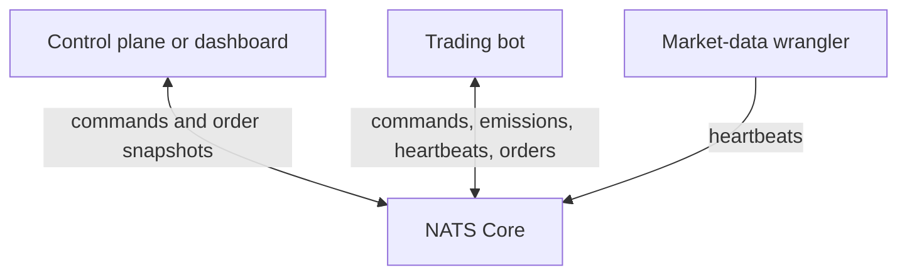

# Hermes

Hermes is a lightweight messaging layer for operating and observing automated trading bots. It gives bot processes, a market-data wrangler, and control-plane applications a shared protocol for:

- publishing health and lifecycle heartbeats;
- streaming bot emissions such as logs, metrics, and risk events;
- sending commands to bots and receiving responses;
- fetching a bot's current active-order state; and
- notifying consumers when that order state changes.

Hermes transports these messages over [NATS Core](https://docs.nats.io/nats-concepts/core-nats) using protobuf payloads. The transport is implemented in Rust and exposed to Python through PyO3, so Python applications do not need their own NATS or protobuf integration.

Hermes is **not** a trading engine. It does not place orders, connect to exchanges, own bot state, persist events, or provide delivery guarantees. Bots and the wrangler remain responsible for their own behavior and state.

## Architecture



The workspace contains two libraries:

- `crates/hermes-core` — async Rust transport built on `async-nats`, plus Prost-generated types from `proto/trading/v1`.
- `crates/hermes-python` — native PyO3 extension exposed privately as `hermes._native`.
- `python/hermes` — typed public Python package that re-exports the native API.

The `.proto` files define the wire format shared by all participants. `services.proto` documents an observability service shape, but Hermes currently uses NATS subjects directly and does not generate or run gRPC clients or servers.

## Supported workflows

### Bot and wrangler liveness

Bots publish their identity, status, start time, optional pause time, and configuration metadata. The singleton wrangler publishes the same lifecycle information without an instance ID. Consumers subscribe to these heartbeats and decide for themselves when a producer should be considered offline.

Hermes does not schedule heartbeats or enforce an expiry interval. Timestamp values are supplied by callers; their units are not currently enforced by the protocol.

### Bot emissions

Bots can publish arbitrary typed JSON objects for observability—for example, a risk warning, strategy decision, or diagnostic event. Emissions use a bounded, non-blocking queue so a slow NATS connection does not block a latency-sensitive producer.

`HermesCore::try_publish_emission` and Python's `try_emit` return immediately. They report `QueueFull`/`QueueFullError` if the configured queue is full. The returned receipt can be awaited to detect a publish error, but it is not an acknowledgment from a subscriber.

### Bot commands

A caller sends a typed command to one bot using NATS request/reply. Supported protocol command types are pause, unpause, get configuration, and modify configuration. The bot handles the request and responds with success or failure, optional JSON data, and the same command ID.

When no command ID is supplied, Hermes generates a UUID. A timeout stops the caller from waiting but does not cancel bot execution. Retrying can therefore execute a command more than once unless the bot deduplicates command IDs.

### Managed bot sessions

Python bots can delegate heartbeat scheduling and command consumption to a Rust-owned `BotSession`. The session starts in `STATUS_WARMING_UP`, publishes heartbeats immediately and periodically, and handles pause, unpause, and get-config commands without involving strategy code.

```python
import asyncio
import time

import hermes


async def run_strategy_iteration() -> None:
    ...


async def main() -> None:
    client = await hermes.Hermes.connect("nats://127.0.0.1:4222")
    bot = await client.start_bot(
        "bot-1",
        started_at=time.time_ns(),
        heartbeat_interval_seconds=5.0,
        config_json='{"strategy":"market_maker"}',
    )

    @bot.on_command
    async def handle_command(command: hermes.BotCommand) -> object:
        if command.type == hermes.COMMAND_TYPE_MODIFY_CONFIG:
            bot.set_config(command.data_json)
            return {"applied": True}
        return {"handled": False}

    bot.mark_online()
    try:
        while bot.is_active():
            if bot.is_paused():
                await bot.wait_until_active()
                continue
            await run_strategy_iteration()
    finally:
        await bot.stop()


asyncio.run(main())
```

`is_active()` remains true while paused and becomes false during shutdown. Pause and unpause commands update the session state before their successful response is sent, so the strategy loop observes the new state immediately. `wait_until_active()` returns when the session becomes online or stops. Custom callbacks run sequentially and may be synchronous or asynchronous; their return value must be `None`, a JSON-object string, or another JSON-serializable object. Callback exceptions are returned to the command caller as failed responses without terminating the session.

### Active orders

The bot's order store is authoritative; Hermes only transports snapshots and change notifications.

A consumer should:

1. Subscribe to order-change notifications.
2. Request the bot's current active-order snapshot.
3. Refetch when a newer version or generation is announced.
4. Refetch after reconnecting, because notifications are not retained.

Each bot process uses a nonempty `generation_id`, normally changed after restart, and increments `version` whenever its order state changes. Snapshots are limited to **1 MiB of encoded protobuf**. Prices and quantities are decimal strings to preserve exact values without floating-point conversion.

## NATS subjects

| Subject | Payload | Pattern |
| --- | --- | --- |
| `hermes.bot.<bot_id>.emissions` | `BotEmission` | Publish/subscribe |
| `hermes.bot.<bot_id>.commands` | `BotCommand` → `BotCommandResponse` | Request/reply |
| `hermes.bot.<bot_id>.orders.snapshot` | `BotActiveOrdersRequest` → `BotActiveOrdersSnapshot` | Request/reply |
| `hermes.bot.<bot_id>.orders.changed` | `BotOrdersChanged` | Publish/subscribe |
| `hermes.heartbeats.bots` | `BotHeartbeat` | Publish/subscribe |
| `hermes.heartbeats.wranglers` | `WranglerHeartbeat` | Publish/subscribe |

Bot IDs become individual NATS subject tokens. They must be nonempty and may contain only ASCII letters, digits, `_`, and `-`.

Hermes uses NATS Core rather than JetStream. Messages are ephemeral: subscribers must be connected before publication, and consumers must recover current state after a disconnect. A successful publish only means that the NATS client accepted the message; it does not prove that a subscriber received or processed it.

## Python quick start

### Prerequisites

- a Rust toolchain;
- Python and a virtual environment;
- `protoc` for protobuf code generation;
- a running NATS server; and
- [Maturin](https://www.maturin.rs/) to build the extension.

Install the extension into the active Python environment:

```sh
python -m pip install maturin
maturin develop
```

Connect, subscribe, and publish an emission:

```python
import asyncio
import hermes


async def main():
    client = await hermes.Hermes.connect(
        "nats://127.0.0.1:4222",
        emission_capacity=4096,
    )

    emissions = await client.subscribe_bot_emissions("bot-1")

    receipt = client.try_emit(
        "bot-1",
        "risk_alert",
        '{"reason":"exposure_limit"}',
    )
    await receipt.wait()  # Publish result, not subscriber acknowledgment.

    event = await emissions.next()
    if event is not None:
        print(event.bot_id, event.emission_type, event.data_json)


asyncio.run(main())
```

Publish and observe heartbeats:

```python
heartbeats = await client.subscribe_bot_heartbeats()

await client.publish_bot_heartbeat(
    "bot-1",
    hermes.STATUS_ONLINE,
    started_at=1730000000,
    config_json='{"strategy":"market_maker"}',
)

heartbeat = await heartbeats.next()
print(heartbeat.source_id, heartbeat.status, heartbeat.config_json)
```

Send a bot command:

```python
response = await client.request_bot_command(
    "bot-1",
    hermes.COMMAND_TYPE_PAUSE,
    data_json='{"reason":"operator_request"}',
    timeout_seconds=5.0,
)

if not response.success:
    raise RuntimeError(response.error)
```

JSON arguments such as `data_json` and `config_json` must contain JSON objects. Subscription `next()` methods return `None` when their subscription ends.

## Active-order JSON format

Python order responders pass `orders_json` as an array of objects:

```json
[
  {
    "venue": "example",
    "symbol": "BTC-USD",
    "order_id": "venue-order-123",
    "client_order_id": "bot-order-123",
    "side": "buy",
    "status": "open",
    "limit_price": "65000.25",
    "total_quantity": "0.10",
    "filled_quantity": "0.02"
  }
]
```

All fields are strings except `limit_price`, which may be `null`. Unknown or incorrectly typed fields raise `ValueError` before a request is consumed. An active-order request can be answered only once.

## Repository layout

```text
.
├── crates/
│   ├── hermes-core/       # Rust NATS transport and generated protobuf API
│   └── hermes-python/     # Async Python bindings
├── proto/trading/v1/      # Versioned protobuf wire definitions
├── Cargo.toml             # Rust workspace
└── buf.yaml               # Protobuf lint configuration
```

## Examples

With a NATS server running at `nats://127.0.0.1:4222`, run either client from the repository root:

```sh
python examples/basic.py
cargo run -p hermes-core --example basic
```

The Python example uses the public `hermes` package. The Rust example uses `HermesCore` directly. Both subscribe before publishing because NATS Core does not retain emissions.

## Build and test

From the repository root:

```sh
buf lint
buf build
cargo test --workspace
```

`cargo check` and the Rust tests do not require a live NATS server for their current unit coverage. Running an application against Hermes does require NATS. No JetStream setup is needed.

## Delivery and recovery semantics

Hermes deliberately favors a small, low-latency transport over durable messaging:

- publish/subscribe messages are not retained;
- publish success is not a processing acknowledgment;
- subscriptions should be established before producers publish;
- request timeouts do not cancel remote work;
- command handlers should deduplicate command IDs when retries are possible;
- order notifications are refresh hints, not an order history; and
- consumers should refetch authoritative state after gaps or reconnects.

These constraints make Hermes suitable for live control and observability while keeping durable business state in the systems that own it.
